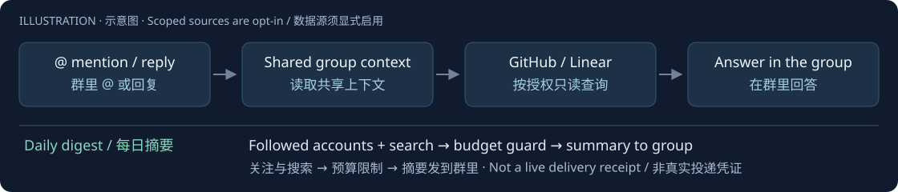

# Hermes Group Agent

A Telegram group assistant with shared conversation context, scoped read-only GitHub/Linear access, and a configurable, budget-limited X/Twitter digest, built on unmodified Hermes.

<!-- readme-illustrate:group-flow-en -->


Illustration: @mention → shared context → scoped sources → reply; daily digest.
<!-- /readme-illustrate:group-flow-en -->
[中文](README.zh-CN.md) · [AI setup entry](SKILL.md)

## Who it is for

Small groups that want an assistant to answer when mentioned, recall group discussion, read explicitly shared project data, and deliver a daily digest. Each group gets its own Bot, credentials, memory and `HERMES_HOME`. Everyone in the allowed group can query connected data: use group-safe, narrowly scoped read-only credentials.

## See it work in three minutes

With Hermes v0.23.0 already installed, run the offline suite and initialize a disposable instance. No Bot token, model request, Apify run or Telegram message is needed:

```sh
export HERMES_REPO="$HOME/apps/hermes-agent"
export HERMES_HOME="$(mktemp -d)/group-instance"
"$HERMES_REPO/.venv/bin/python" -m unittest discover -s tests -v
bash deploy/install.sh
cat "$HERMES_HOME/twitter/digest.yaml"
```

This demonstrates code and initialization, not live service acceptance. A fresh dependency install may take longer. For live use, choose a persistent isolated directory, create your Bot, disable privacy mode before adding it to the group, and fill the private configuration below.

## Install

Prerequisites: Git and [uv](https://docs.astral.sh/uv/getting-started/installation/). The one-command initializer installs Hermes v0.23.0 with its lockfile on Python 3.14 and seeds an isolated instance:

```sh
export HERMES_REPO="$HOME/apps/hermes-agent"
export HERMES_HOME="$HOME/.hermes-my-group"
bash deploy/bootstrap.sh
```

It does not start a gateway. In `$HERMES_HOME/.env`, privately fill `MODEL_API_KEY`, `TELEGRAM_BOT_TOKEN`, `TELEGRAM_ALLOWED_USERS` (DM owners), and both `TELEGRAM_ALLOWED_CHATS` / `TELEGRAM_GROUP_ALLOWED_CHATS` (target group only). Default model/provider are examples; select your own supported provider and budget in `config.yaml`. Keep credentials mode 600. Start only one update consumer per Bot. See the [Bot setup checklist](references/telegram-setup-task.md).

The default assistant responds to @mentions/replies and observes other messages for shared group context. Ordinary group members can use the native commands in an allowed group:

- `/follow username [note]`: verify the exact X profile before writing YAML; reply with display name and follower count.
- `/unfollow username`: remove the account, case-insensitively.
- `/following`: show handles and notes.

Register these names in BotFather's command menu; Telegram supports `/follow@YourBot username`. Keep any additional Hermes slash ACL or group sender allowlist compatible with all intended group members. Commands reject DMs, CLI and other groups; there is no command-specific owner gate. No Hermes source patch is needed.

`twitter/digest.yaml` is the only active digest config: account notes, each hot route's keywords/language/minimum likes/result count, daily run/item caps and digest maximum. Comments and quotes survive locked atomic edits. A legacy `accounts.txt` migrates automatically before deletion; reinstall preserves operator YAML. `digest.defaults.yaml` is migration-only. Changes are persisted immediately and read by the next digest; an already-running digest uses its starting snapshot. The example account list is for replacement.

For the digest, put your Apify token in `$HERMES_HOME/secrets/apify.key` (mode 600); manual execution can use `APIFY_TOKEN`. Set `TWITTER_DIGEST_USER_ID` to the destination group or user, and `TWITTER_DIGEST_ERROR_USER_ID` to a positive private user ID. The error recipient must first DM `/start` to the Bot. Rerun `deploy/install.sh` to register the native cron. Success may go to the group; failures explicitly use `--failure-deliver telegram:<private user>`. Existing jobs are preserved: use `hermes cron edit` to update their prompt and failure destination. Schedule and timezone can be set using `TWITTER_DIGEST_SCHEDULE` and `TWITTER_DIGEST_TIMEZONE` (defaults 09:00 UTC).

The digest uses [Kaito's tweet Actor](https://apify.com/kaitoeasyapi/twitter-x-data-tweet-scraper-pay-per-result-cheapest) for followed accounts plus English/Chinese hot searches, filtered to the last 24 hours. Output has two sections, **关注的人** / **全网热门**, Chinese summaries, continuous numbering and original links. The prompt takes the total limit from YAML and reserves 1–2 Chinese hot items when qualified valuable candidates exist, within that total. Model compliance must be checked with real output.

Default digest budget: 3 runs and 300 reserved rows per Singapore calendar day, at a guarded ceiling of $0.00025/row ($0.075/day). Profile verification uses [API Dojo's profile Actor](https://apify.com/apidojo/twitter-user-scraper): $0.004/profile query plus $0.0004/returned profile, hard run cap $0.005; default 10 attempts/day in a separate budget ($0.05/day reserved). Startup validates supported pricing/events; failures, empty results and uncertain launches consume reservations, and paid POSTs are never retried. Caps exclude model costs. Actors may under-return or include charged placeholder rows; these are filtered. Unconfirmed profiles are not added. Invalid usernames and duplicate follows cost no Apify calls. Usage can settle after completion; re-read run billing. Daily accounting currently uses UTC+8 independently of cron timezone.

Deduplication is a handoff to the model, not a delivery receipt; failed model/delivery attempts do not automatically restore candidates. Offline `--fixture` costs nothing; a real `--dry-run` still calls Apify and reserves budget.

GitHub and Linear MCPs default to disabled. Enable only after inspecting scope-limited read-only credentials and the actual tools list; official read-only endpoints and disabled sampling are preconfigured. Jev ambient routing remains optional and off; [SKILL.md](SKILL.md) explains disclosure, conservative thresholds and recovery. Do not disable the mention gate alone.

After the checks below, explicitly start the instance:

```sh
bash "$HERMES_HOME/start.sh"
```

Use [keepalive.snippet](deploy/keepalive.snippet) as an optional supervisor example, preserving other services. Installation does not add a system service. Instance files are shared memory, so keep personal private data in a different instance.

## Acceptance

| Level | Required evidence |
|---|---|
| Code complete | Offline tests, real Hermes config/tool checks, plugin discovery/context dispatch, migration and repeated isolated installs. See [checks](checks/README.md). |
| Live integrations pass | @/reply and group-context retrieval, all members' follow commands, other-group/DM rejection, scoped MCP read-only tool inventory, real bounded Apify lookup/digest and actual two-section model output plus delivery records. |
| Running in production | Operator verifies deployed version, credentials, supervisor, restart behavior, and at least 24 hours of healthy scheduled delivery. |

A successful test suite is not evidence of deployment or Telegram delivery. This repository ships no real credentials or acceptance claims about your future installation.

## Known pitfalls

- Changing the Bot can collide with message numbers stored in old sessions: use `/reset` in the relevant conversation after switching.
- Real `--dry-run` consumes the daily budget and Apify allowance; use `--fixture` for offline testing.
- `cron.wrap_response: false` removes cron headers/footers.
- `platforms.telegram.extra.disable_link_previews: true` disables link previews.
- Bot privacy must be disabled before adding it; a group-to-supergroup conversion changes the group ID.
- One Bot token allows one update consumer. Do not run `getUpdates` beside a running gateway.
- Python 3.13 may report a version while missing core dependencies; use Python 3.14 and the Hermes lockfile.
- Never disable TLS certificate checks. Repair the trust chain instead.
- Read-only access limits writes, not which group member can read the connected data.
