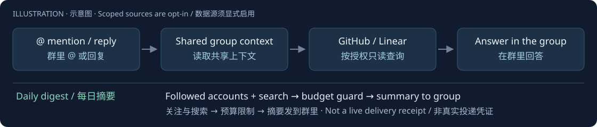

# Hermes Group Agent

基于原版 Hermes 的 Telegram 群助手：@ 回答、共享群上下文、GitHub/Linear 只读查询，以及可配置、有限额的推特日报。

<!-- readme-illustrate:group-flow-zh -->


示意图：群里 @ → 共享上下文 → 授权数据源 → 回答；每日摘要单独受预算限制。
<!-- /readme-illustrate:group-flow-zh -->
[English](README.md) · [让 AI 帮你搭](SKILL.md)

## 适合谁

适合希望从群讨论找回上下文、查询明确共享的项目资料、每天接收关注账号和中英文热门摘要的小群。每个群独立 Bot、凭据、记忆和 `HERMES_HOME`。群里任何成员都能问接入的资料，只接群成员都可看的内容，并使用限定范围的只读凭据。

## 三分钟见效

已有 Hermes v0.23.0 环境时，可以先离线跑测试、生成临时实例，不需要 Bot token，不会调用模型、Apify 或 Telegram：

```sh
export HERMES_REPO="$HOME/apps/hermes-agent"
export HERMES_HOME="$(mktemp -d)/group-instance"
"$HERMES_REPO/.venv/bin/python" -m unittest discover -s tests -v
bash deploy/install.sh
cat "$HERMES_HOME/twitter/digest.yaml"
```

这一步证明代码和初始化可用。首次下载依赖可能更久；真实接入还需要自己的 Bot、模型和 Apify 凭据。正式使用请换成持久化的隔离目录。

## 安装

先安装 Git 和 [uv](https://docs.astral.sh/uv/getting-started/installation/)，然后一条命令初始化：

```sh
export HERMES_REPO="$HOME/apps/hermes-agent"
export HERMES_HOME="$HOME/.hermes-my-group"
bash deploy/bootstrap.sh
```

脚本检出 Hermes v0.23.0，用 Python 3.14 和锁文件装依赖，生成隔离实例，不启动网关。私下填写 `$HERMES_HOME/.env` 的 `MODEL_API_KEY`、`TELEGRAM_BOT_TOKEN`、允许私聊的 `TELEGRAM_ALLOWED_USERS`，以及只包含目标群的 `TELEGRAM_ALLOWED_CHATS` / `TELEGRAM_GROUP_ALLOWED_CHATS`。默认 provider 和模型仅作示例，请在 config.yaml 选择自己的可用服务和预算。凭据权限保持 600。Bot 设置见[检查单](references/telegram-setup-task.md)：先关隐私模式，再加群；同一个 token 只能有一个消息消费者。

默认被 @ 或回复才回答，其他消息进入群上下文。目标群所有成员都可以使用原生斜杠命令：

- `/follow 用户名 [备注]`：先精确验证 X 账号，再写配置，回复显示名和粉丝数。
- `/unfollow 用户名`：忽略大小写移除。
- `/following`：列出名单及备注。

在 BotFather 命令菜单登记 follow、unfollow、following；群里也可用 `/follow@你的Bot 用户名`。如另设 Hermes slash ACL 或群成员白名单，需允许预期成员使用；插件本身没有管理员限制。私聊、CLI、其他群拒绝修改，不改 Hermes 源码。

唯一生效配置为 `twitter/digest.yaml`：关注账号及备注、每路热门的关键词/语言/点赞门槛/条数、每日调用和条数上限、摘要总条数。固定锁、原子替换、保留注释和引号；旧 accounts.txt 成功迁移后删除，重装不覆盖已编辑 YAML。digest.defaults.yaml 只供迁移使用。群命令改完立即落盘，下次日报读取；已开始的日报使用启动时快照。示例账号请自行替换。

日报使用自己的 Apify token，写入 `$HERMES_HOME/secrets/apify.key` 并设为 600；手动运行可用 `APIFY_TOKEN`。在 `.env` 设置 `TWITTER_DIGEST_USER_ID` 为投递群或用户，`TWITTER_DIGEST_ERROR_USER_ID` 必须是正数私信用户 ID，先向 Bot 发过 `/start`。重跑 install.sh 创建原生 cron。成功可投群，失败使用独立 `--failure-deliver` 只私信。已有任务会保留，升级时用 `hermes cron edit` 显式更新 prompt 和失败接收人；时间和时区可用 TWITTER_DIGEST_SCHEDULE / TWITTER_DIGEST_TIMEZONE 设置，默认 UTC 09:00。

使用 [Kaito 推文 Actor](https://apify.com/kaitoeasyapi/twitter-x-data-tweet-scraper-pay-per-result-cheapest)，关注账号和中英文热门分路查询，过滤过去 24 小时，按「关注的人」「全网热门」两块排版，连续编号、中文要点和原文链接。摘要总条数由 YAML 传入；有合格且有价值候选时保留 1～2 条中文热门，并受总上限约束，模型实际遵守情况须验收。

默认日报每日 3 次、预留 300 行，价格守卫最高 $0.00025/行，即 $0.075/天。关注验证使用 [API Dojo profile Actor](https://apify.com/apidojo/twitter-user-scraper)，当前 $0.004/查询加 $0.0004/返回账号，单次硬上限 $0.005，独立预算默认每天十次、最多预留 $0.05；不抓粉丝/关注列表。每次启动前核对计费事件及价格；失败、超时、无结果照样占预留预算，不重试付费 POST。非法用户名和重复关注不发付费请求；未确认账号不写入。以上不含模型费用。即时账单可能未结算，需要稍后回读 run；Actor 不保证返回数量，收费占位行会被过滤。每日预算按 UTC+8 自然日核算，独立于 cron 时区。

去重代表交给模型，不代表送达；模型或投递失败不会自动恢复候选。`--fixture` 完全离线，真实 `--dry-run` 仍调用 Apify、占预算。

GitHub/Linear MCP 默认关闭，凭据本身和服务端点都要只读，且限定资料范围；启用前检查真实工具清单。Jev 主动路由可选且默认关闭，需明确上下文会发给外部服务，再按 [SKILL.md](SKILL.md) 同步启用插件与调整 mention gate，不能单独关闭 @ 门槛。

完成下面的验收准备后，手动启动：

```sh
bash "$HERMES_HOME/start.sh"
```

需要保活时参考 [keepalive.snippet](deploy/keepalive.snippet)，保留其他服务；安装不会自动注册系统服务。记忆属于整个实例，私密个人资料请放另一个实例。

## 验收

| 档位 | 需要的证据 |
|---|---|
| 代码完成 | 离线测试、真实 Hermes 配置和工具检查、插件发现及上下文分派、迁移和重复安装通过，见 [checks](checks/README.md)。 |
| 真实接入通过 | 群内 @/回复和上下文、全体成员关注命令、其他群与私聊拒绝、MCP 只读工具清单、有限额真实 Apify、实际模型两块排版和原生投递记录。 |
| 已上线 | 部署版本、凭据与保活核对，重启正确，至少连续 24 小时健康运行和按时投递。 |

测试通过不能替代部署或 Telegram 送达。本仓库不附带真实凭据，也不预先声称你的实例已上线。

## 已知坑

- 换 Bot 后可能与旧会话消息编号冲突，在相关会话 `/reset`。
- 真实 dry-run 也占每日预算和 Apify 额度；离线测试用 fixture。
- `cron.wrap_response: false` 去掉 cron 头尾。
- `platforms.telegram.extra.disable_link_previews: true` 关闭链接预览。
- 先关闭隐私模式，再拉 Bot 入群；普通群升级后 ID 会变化。
- 同 token 只能有一个更新消费者，网关运行时不要旁路 getUpdates。
- Python 3.13 可能能输出版本却缺核心依赖，用 3.14 和锁文件。
- HTTPS 证书有问题应修复证书链，不能关闭校验。
- 只读限制写入，不限制目标群里谁能读取接入资料。
